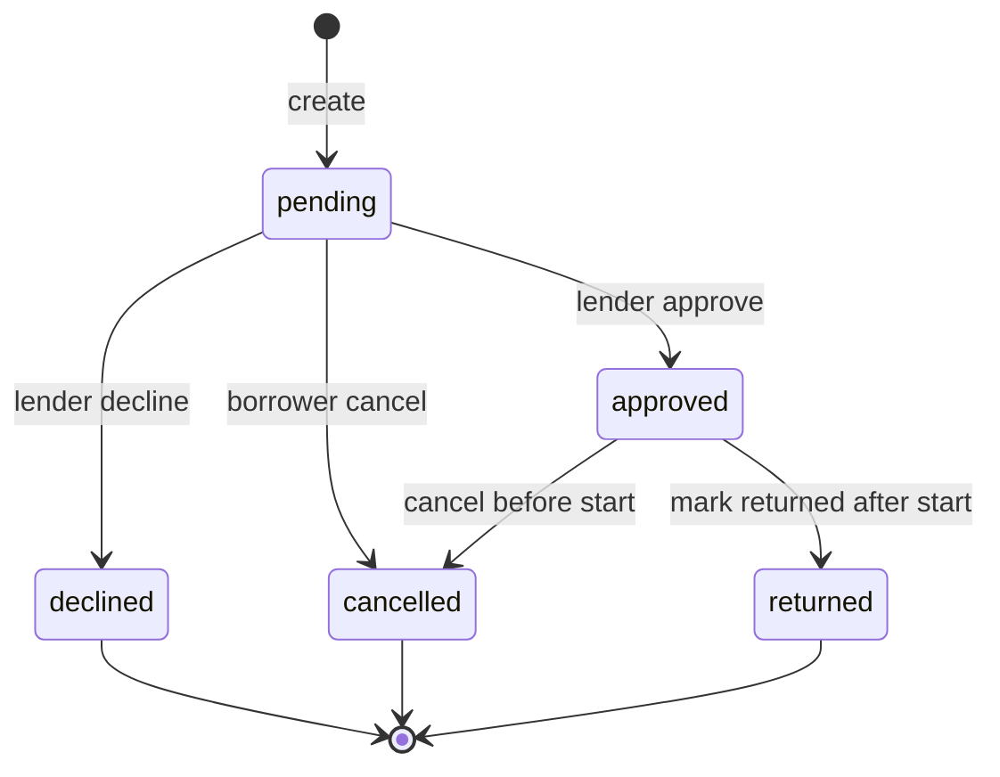
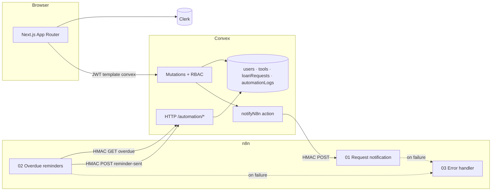

# LendLoop

Neighborhood tool-lending: list tools, request date ranges, approve or decline, mark returns. **Convex** owns data and rules; **Clerk** signs users in; **n8n** runs notifications and overdue reminders.

## Contents

- [What it does](#what-it-does)
- [Architecture](#architecture)
- [Where to look in the code](#where-to-look-in-the-code)
- [Stack](#stack)
- [Local setup](#local-setup)
- [Environment variables](#environment-variables)
- [Security](#security)
- [Testing](#testing)
- [What I would change next](#what-i-would-change-next)

## What it does

| Surface | Behavior |
| --- | --- |
| `/` **(public)** | Tagline, read-only tool list (**name + category only**), sign-in CTA. |
| `/tools` | Paginated neighbor board (category filter, booked-range hints, “out until” when loaned). **My listings:** CRUD, pause/resume visibility, pending counts, mark returned from the row when appropriate. |
| `/loans` | **Incoming** (approve / decline / return), **My requests** (cancel pending or upcoming reservation, overdue styling), **All loans** (admin). Rows show recent automation activity. |
| **Admin (in context)** | Trusted-lender toggle and remove any listing from the board or loans admin tab — no separate console. Bootstrap admin via `INITIAL_ADMIN_EMAIL` on first sign-in. |

### Loan lifecycle

Convex stores `pending`, `approved`, `declined`, `cancelled`, and `returned` only. **Reserved**, **on loan**, and **overdue** are derived from `startDate` / `endDate` while the row stays `approved`; workflow **02** logs `overdue_reminder` without changing status.

| Actor | Action | Notes |
| --- | --- | --- |
| Borrower | Request | Blocks self-borrow, hidden tools, overlapping approved loans, duplicate active request on the same tool. |
| Borrower | Cancel | Pending: borrower only. Approved **before** start: lender or borrower. After start → `markReturned` only. |
| Lender | Approve / decline | Approve auto-declines overlapping **pending** requests on that tool. |
| Either party | Return | After borrow period has started; notifies the other party. |



**Listing locks (enforced in Convex, mirrored in UI):** cannot edit or remove a listing while an approved borrow is open; cannot put a tool back on the board while it is out on loan. Hidden listings are not borrow targets.

**Roles:** `admin` \| `user` on the Convex `users` row — never from the client. `requireUser` / `requireAdmin` / ownership and party checks on every mutation; `(app)/layout.tsx` only keeps signed-out users off app routes.

## Architecture



**Request notification:** a lending mutation schedules `automation.notifyN8n`, which builds a minimal payload, signs it, and POSTs to n8n **01** (inline retries on failure). n8n verifies HMAC, delivers (local demo: console log), responds 200; Convex records `automationLogs` and the loan row footnote updates.

**Overdue:** n8n **02** (daily or manual) HMAC-GETs `/automation/overdue-loans` — approved loans past `endDate` not yet reminded today — then delivers reminders and POSTs idempotent `reminder-sent` rows (`overdue:{loanRequestId}:{date}`).

**Why Docker locally:** self-hosted Convex and n8n share the compose network (`http://n8n:5678`, `http://convex:3211`) so webhooks work without a tunnel.

| Layer | Responsibility |
| --- | --- |
| `src/app/` | Thin routes; `(app)/layout.tsx` calls `auth.protect()` once |
| `src/features/*` | Tools, loans, home — RSC shells + client islands |
| `convex/` | Auth helpers, lending rules, HTTP actions, outbound n8n |
| `n8n/` | Exported workflows; secrets in `.env.docker` / Convex env only |

## Where to look in the code

| Topic | Start here |
| --- | --- |
| RBAC and party checks | `convex/lib/auth.ts`, `convex/loanRequests.test.ts`, `convex/tools.test.ts` |
| Overlap, reservations, listing locks | `convex/lib/loans.ts`, `convex/loanRequests.ts`, `convex/tools.ts` |
| HMAC (POST body + signed GET) | `convex/lib/hmac.ts`, `convex/http.ts` |
| Overdue query + idempotent write-back | `convex/automation.ts`, `convex/automation.test.ts` |
| Outbound n8n | `convex/lib/scheduleLoanNotification.ts`, `convex/automation.ts` |
| Workflows | `n8n/0*.json` (import via `npm run n8n:import`), [`n8n/README.md`](n8n/README.md) |
| Loan row automation copy | `src/features/loans/utils/loanActivityFootnotes.ts`, `LoanAutomationFootnote.tsx` |
| Design tokens | `src/app/globals.css`, `src/components/ui/` |

## Stack

Next.js 16 · TypeScript · Tailwind 4 · Clerk · Convex (self-hosted in dev) · n8n · Vitest · convex-test

## Local setup

Docker Desktop, Node 20+, [Clerk](https://dashboard.clerk.com) dev app.

### First time

| # | Command / action |
| --- | --- |
| **1** | `npm install` · `cp .env.example .env.local` |
| **2** | Fill `.env.local` (Clerk table below) |
| **3** | `npm run setup` |
| **4** | `npm run dev` · sign in as `INITIAL_ADMIN_EMAIL` · `npm run seed` |

### Clerk (step 2)

| `.env.local` | Clerk |
| --- | --- |
| `NEXT_PUBLIC_CLERK_PUBLISHABLE_KEY` | API keys → Publishable |
| `CLERK_SECRET_KEY` | API keys → Secret |
| `CLERK_JWT_ISSUER_DOMAIN` | [Convex integration](https://clerk.com/docs/integrations/databases/convex) or JWT template **`convex`** → Issuer |
| `INITIAL_ADMIN_EMAIL` | Sign-in email |

### Retest

| # | Command / action |
| --- | --- |
| **1** | `npm run reset:local` |
| **2** | `npm run setup` |
| **3** | `npm run dev` · sign in as `INITIAL_ADMIN_EMAIL` |
| **4** | `npm run seed` |

Convex data UI: [http://127.0.0.1:6791](http://127.0.0.1:6791) (`CONVEX_SELF_HOSTED_ADMIN_KEY` in `.env.local`).

## Environment variables

| Variable | Where |
| --- | --- |
| Clerk, `INITIAL_ADMIN_EMAIL`, `CLERK_JWT_ISSUER_DOMAIN` | `.env.local` (before `npm run setup`) |
| `CONVEX_SELF_HOSTED_*`, `NEXT_PUBLIC_CONVEX_URL`, `CONVEX_SITE_URL` | `.env.local` (written by setup) |
| `WEBHOOK_HMAC_SECRET`, `CONVEX_INSTANCE_SECRET`, n8n `CONVEX_SITE_URL` | `.env.docker` (created by setup) |
| `N8N_REQUEST_WEBHOOK_URL`, HMAC secret, issuer, admin email | Convex deployment env (synced by setup) |

## Security

- **Authorization in Convex**, not in Next.js path matchers — UI hides actions the server would reject anyway.
- **Public data minimal** — anonymous queries return tool name and category only; signed-in users see first names, not emails (admins see more on admin surfaces).
- **Automation HTTP is HMAC-only** — raw-body verification for POST; timestamp + path for overdue GET; shared secret in env, not in workflow exports.
- **Idempotent automation logs** — reminder and notification keys prevent duplicate rows on retry; overdue list skips loans already reminded today.
- **Input bounds** — date rules, overlap checks, and text validation on the server (`convex/lib/rules.ts` where shared with forms).

Production would move off the single Docker host: hosted Convex, real SMTP (or SES), stable public webhook URL, and Clerk-driven user lifecycle if you outgrow `ensureCurrentUser`.

## Testing

```bash
npm test    # convex-test (RBAC, overlap, cancel/return paths, automation HMAC + idempotency) + component/lib Vitest
npm run lint
```

Critical paths are exercised against Convex directly (acting as lender, borrower, stranger, admin) — not only through React.

## What I would change next

1. **Delivery guarantees** — transactional outbox with backoff and admin retry (today: `notifyN8n` runs after the mutation with a short inline retry loop; local proof is n8n execution + footnotes).
2. **Real email in dev** — Mailpit or similar instead of console delivery in n8n.
3. **Atomic send claim** — record “about to send” before SMTP/console so a failed write-back cannot double-send on retry.
4. **Future-dated bookings** — approving currently treats the tool as reserved/on loan immediately; product may want “reserved until start” on the board only.
5. **Hosted ops** — managed Convex + n8n with queue mode, secret rotation, and tested backup restore.
