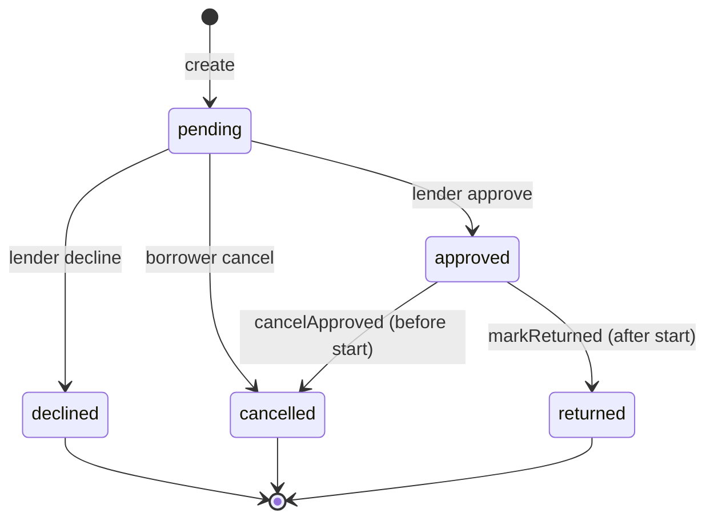

# LendLoop

Neighborhood tool-lending: list tools, request date ranges, approve or decline, mark returns. **Convex** owns data and rules; **Clerk** signs users in; **n8n** runs notifications and overdue reminders.

## Contents

- [How the brief is met](#how-the-brief-is-met)
- [Stack](#stack)
- [Local setup](#local-setup)
- [Architecture](#architecture)
- [Environment variables](#environment-variables)
- [Security & production](#security--production)

## How the brief is met

### Product surfaces

| Surface          | Behavior                                                                                                                                                                                                                                                                                             |
| ---------------- | ---------------------------------------------------------------------------------------------------------------------------------------------------------------------------------------------------------------------------------------------------------------------------------------------------- |
| `/` **(public)** | Tagline, read-only pool via `tools.listPublic` (name + category only), sign-in CTA. No owner ids or emails on anonymous queries.                                                                                                                                                                     |
| `/tools`         | Neighbor board (paginated, category filter): borrow modal with date validation, booked-range hints, “out until” when someone else holds the tool. **My listings**: create/edit/delete, pause/resume board visibility, pending-request counts, mark returned from the row when a loan is in progress. |
| `/loans`         | **Incoming** (approve / decline / return), **My requests** (cancel pending, cancel upcoming reservation, overdue cues), **All loans** (admin). Loan rows show recent automation activity.                                                                                                            |

### Borrow & loan lifecycle

Convex stores `pending`, `approved`, `declined`, `cancelled`, and `returned` only — there is no `overdue` status. While `approved`, the UI derives **reserved**, **on loan**, and **overdue** from `startDate` / `endDate` (badge still backed by `approved` until `markReturned`). Past `endDate`, rows show Overdue styling; n8n workflow **02** can log `overdue_reminder` without changing status. `cancelApproved` vs `markReturned` depend on whether the borrow has started (table below). Notifications run on meaningful transitions.

| Actor | Action | Convex | Notes |
| ----- | ------ | ------ | ----- |
| Borrower | Request dates | `loanRequests.create` | Blocks self-borrow, unavailable tools, overlapping approved loans, duplicate active request on same tool. |
| Borrower | Cancel | `cancelPending` / `cancelApproved` | Pending: borrower only. Approved reservation: lender or borrower **before** start date; after start → must `markReturned`. |
| Lender | Approve / decline | `approve` / `decline` | Lender-only. Approve auto-**declines** overlapping **pending** requests on that tool; re-checks availability and approved overlap. |
| Either party | Return | `markReturned` | Only when borrow period has **started**; notifies the other party. |



### Listing, reservation, and board UX

Rules live in `convex/tools.ts`, `convex/loanRequests.ts`, and `convex/lib/loans.ts`; the UI mirrors them (disabled controls + tooltips) so users see the same story Convex enforces.

- **On loan (period started):** edit/remove listing blocked server-side (`toolHasOpenApprovedLoan`); owner can mark returned from My listings or Incoming.
- **Reserved (approved, not started):** edit/remove blocked in UI; either party can cancel the reservation; putting the listing back on the board is blocked while an active loan is in progress.
- **Neighbor board:** shows trusted-lender badge, your pending/approved state on a card, and when a tool is loaned out to someone else (`loanOutUntil` + booked ranges in the borrow modal).
- **Availability toggle:** owner can hide a listing from the board without deleting it (`setAvailability`); hidden tools are not borrow targets.

### Admin (in-context, not a separate console)

- `requireAdmin` on `users.setTrustedLender` and `loanRequests.listAllForAdmin`.
- `requireToolAccess`: admin may remove any listing; owners retain CRUD on their own tools.
- On the **neighbor board** (and signed-in home preview): admin gets remove-listing on any card plus trusted-lender mark/remove with confirm modal — same flows as `/loans` admin tab, without leaving the board.

### Authorization (Convex, not UI-only)

- `convex/lib/auth.ts`: `requireUser`, `requireAdmin`, `assertOwner`, `requireToolAccess` (owner **or** admin for tool mutations).
- Party checks on approve/decline/cancel/return; strangers cannot act on someone else’s request.
- Bootstrap admin via `INITIAL_ADMIN_EMAIL` on first `ensureCurrentUser`.
- `convex-test` **+ Vitest** (`npm test`): overlap, competing pending decline, cancel paths, listing lock while open approved loan, RBAC on trust and removal.

### n8n & automation

- Workflows **01–03** in `n8n/`; HMAC in `convex/lib/hmac.ts`; idempotent `automationLogs`; loan-row footnotes from app copy. Local dev runs **Convex + n8n in Docker** so webhooks need no tunnel. Delivery is **console.log** in n8n (assignment scope); proof is executions + footnotes.

### Frontend

- `--ll-*` tokens and UI primitives; `src/features/*` with RSC shells and client islands; layout-scoped account sync; stale paginated lists; route skeletons.

## Stack

Next.js 16 · TypeScript · Tailwind 4 · Clerk · Convex · n8n · Vitest

## Local setup

**Prerequisites:** Docker Desktop, Node 20+, free [Clerk](https://dashboard.clerk.com) dev application. No paid services.

| # | What you do |
|---|-------------|
| **1** | `npm install`. Copy [`.env.example`](.env.example) → `.env.local`. |
| **2** | Fill the Clerk rows in `.env.local` (table below). `npm run setup` refuses to run until those are set. |
| **3** | `npm run setup` — starts Convex + n8n, deploys backend, syncs secrets, imports workflows. |
| **4** | `npm run dev` → [http://localhost:3000](http://localhost:3000). Sign in with the email you put in `INITIAL_ADMIN_EMAIL`, then `npm run seed`. |

**Clerk → `.env.local`** (Development instance; [API keys](https://dashboard.clerk.com/last-active?path=api-keys) · [JWT templates](https://dashboard.clerk.com/last-active?path=jwt-templates) · [Clerk + Convex guide](https://clerk.com/docs/integrations/databases/convex))

| Put in `.env.local` | Get it from Clerk |
| ------------------- | ----------------- |
| `NEXT_PUBLIC_CLERK_PUBLISHABLE_KEY` | **API keys** → **Publishable key** (`pk_test_…`) |
| `CLERK_SECRET_KEY` | **API keys** → **Secret key** (`sk_test_…`) — server only, never commit |
| `CLERK_JWT_ISSUER_DOMAIN` | **JWT templates** → template named **`convex`** → **Issuer** (see below) |
| `INITIAL_ADMIN_EMAIL` | Your own sign-in email (bootstrap admin in Convex) |

Leave `NEXT_PUBLIC_CLERK_SIGN_IN_URL` and `NEXT_PUBLIC_CLERK_SIGN_UP_URL` as in `.env.example` unless you changed routes.

**`convex` JWT template (once per Clerk app):** In the dashboard, open **JWT templates** → **New template** → choose **Convex** (or follow the [integration doc](https://clerk.com/docs/integrations/databases/convex)). Name it **`convex`**. Ensure the template exposes **`email`** (and verification) the way that doc describes. Save, then copy **Issuer** into `CLERK_JWT_ISSUER_DOMAIN`.

**If step 3 fails on n8n import:** open [http://localhost:5678](http://localhost:5678), complete the one-time owner signup, then `npm run n8n:import`. Confirm workflows **03 → 01 → 02** are **Active**.

**Try automations:** two browser profiles — list + request → approve → footnote on loan row; for overdue, use seeded data and run workflow **02** in n8n. Details: [`n8n/README.md`](n8n/README.md).

```bash
npm test && npm run lint
```

## Architecture

| Layer | Responsibility |
|--------|----------------|
| `src/app/` | Routes, layouts — `(app)/layout.tsx` calls `auth.protect()` once |
| `src/features/*` | Tools, loans, home, account |
| `convex/` | Auth helpers, lending rules, HTTP actions, outbound n8n |
| `n8n/` | Exported workflows; secrets in `.env.docker` / Convex env only |

Clerk guards routes; **authorization lives in Convex**. Notify: mutation → signed POST to n8n → `automationLogs`. Overdue: n8n → signed Convex HTTP → idempotent reminder log.

## Environment variables

| Variable | Where |
|----------|--------|
| Clerk, `INITIAL_ADMIN_EMAIL`, `CLERK_JWT_ISSUER_DOMAIN` | `.env.local` (before `npm run setup`) |
| `CONVEX_SELF_HOSTED_*`, `NEXT_PUBLIC_CONVEX_URL` | `.env.local` (written by setup) |
| `WEBHOOK_HMAC_SECRET`, `CONVEX_INSTANCE_SECRET`, n8n `CONVEX_SITE_URL` | `.env.docker` (created by setup) |
| `N8N_REQUEST_WEBHOOK_URL`, shared HMAC, issuer, admin email | Convex env (synced by setup) |

## Security & production

Public queries stay minimal; automation HTTP is HMAC-only. Production: hosted Convex, Clerk webhooks for user sync, hosted n8n + SMTP, stable webhook URL.

After seed, `INITIAL_ADMIN_EMAIL` gets demo tools plus sample overdue/incoming loans for workflows **01** and **02**.
